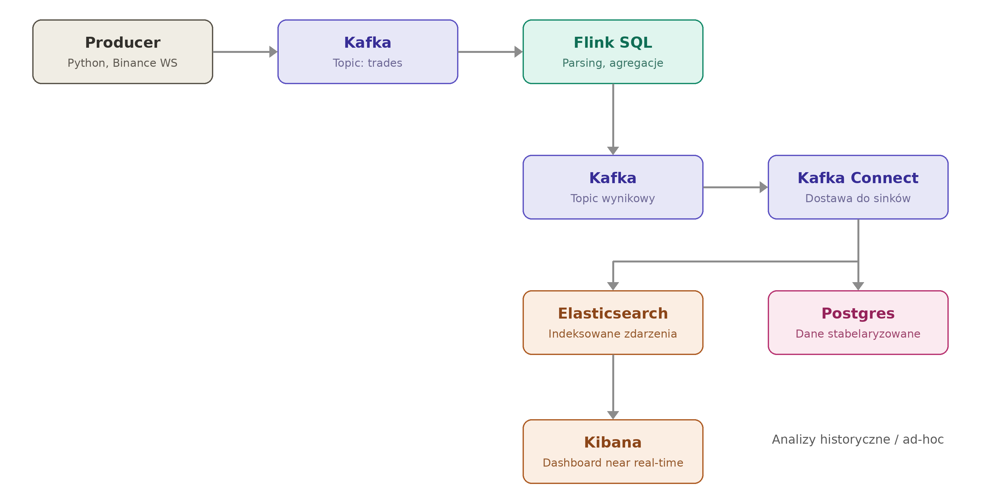

# CryptoStream

> **Status: projekt wstrzymany (2026-11-09).** Infrastruktura stoi, producer
> działa, Flink parsuje surowe trade'y do typowanego topicu. Agregacji i dashboardu
> jeszcze nie ma. Jak wrócić do pracy: sekcja [Powrót do projektu](#powrót-do-projektu).

Pipeline streamingowy end-to-end dla danych z rynku kryptowalut: Binance WebSocket →
Kafka → Flink SQL → Kafka → Kafka Connect → Elasticsearch/Kibana + Postgres.
To projekt portfolio i do nauki data engineeringu.

## Problem, który projekt rozwiązuje

Traderzy kryptowalut potrzebują wglądu w rynek na żywo, żeby szybko reagować na zmiany ceny i wolumenu.
Surowy strumień transakcji z giełdy jest trudny do analizy "gołym okiem" — trzeba go agregować,
liczyć w oknach czasowych i wizualizować, żeby dało się z niego wyciągnąć sensowne wnioski.

Projekt buduje pipeline, który:
- odbiera transakcje z giełdy kryptowalut w czasie rzeczywistym,
- przetwarza je (agregacje, okna czasowe) w locie,
- udostępnia wynik w dwóch formach: dashboard near real-time (do monitorowania na żywo)
  oraz trwałe, ustrukturyzowane dane (do analiz historycznych i zapytań ad-hoc).

## Architektura (docelowa)



## Stan na dziś (as-is)

| Element | Stan | Gdzie |
|---|---|---|
| Producer (Binance → Kafka) | ✅ działa: 5 symboli (`BTC`, `ETH`, `BNB`, `SOL`, `XRP` / `USDT`), strumienie `trade` i `bookTicker`, reconnect z exponential backoff | `producer.py` |
| Kafka (KRaft) | ✅ **1 broker** (w planie 3, decyzja odłożona) | `docker-compose.yml` |
| Kafbat UI | ✅ podpięte pod Schema Registry (dekoduje Avro) | `docker-compose.yml` |
| Flink (JobManager + TaskManager, 6 slotów) | ✅ obraz z konektorem Kafki i Avro-Confluent | `Dockerfile.flink` |
| JupyterLab + PyFlink | ✅ magic `%%sql` wysyła joby na zdalny klaster Flinka | `Dockerfile.jupyter`, `jupyter_startup/00-flink-setup.py` |
| Flink SQL: `raw_trades → processed_trades` | ✅ parsowanie JSON → typowane kolumny (`DECIMAL`, `BIGINT`, `BOOLEAN`, `TIMESTAMP`), wyjście w Avro | `notebooks/flink_sql.ipynb` |
| Eksperymenty z oknami | 🧪 watermark na `trade_time`, okno `HOP`, `GROUP BY` bez okna | `notebooks/Untitled.ipynb` |
| Schema Registry | ✅ | `docker-compose.yml` |
| Kafka Connect → ES i → Postgres | ⚠️ konfiguracje są, rejestruje się je ręcznie (patrz niżej) | `kafka_connect_connectors/` |
| Agregacje (świece OHLCV itd.) | ❌ nie zrobione | — |
| Dashboard w Kibanie | ❌ nie zrobiony | — |
| Topic `raw_book_ticker` | ⚠️ producer go zapełnia, ale Flink go jeszcze nie czyta | — |
| Testy, CI | ❌ brak | — |

### Przepływ danych (jak jest teraz)

```
producer.py (host, venv)
  ─► Kafka: raw_trades (JSON, klucz = symbol)
  ─► Kafka: raw_book_ticker (JSON, klucz = symbol)        ← na razie nikt nie czyta

Flink (job wysłany z notebooka flink_sql.ipynb)
  raw_trades ─► processed_trades (Avro + Schema Registry)

Kafka Connect
  processed_trades ─► Elasticsearch (indeks processed_trades) ─► Kibana
  processed_trades ─► Postgres (tabela tworzona automatycznie, auto.create)
```

## Usługi i porty

| Usługa | URL / port | Uwagi |
|---|---|---|
| Kafka (z hosta) | `localhost:9094` | wewnątrz sieci Dockera: `kafka:9092` |
| Kafbat UI | http://localhost:8080 | |
| Flink UI | http://localhost:8081 | |
| JupyterLab | http://localhost:8888 | bez tokena; `./notebooks` zamontowany jako `/home/jovyan/work` |
| Kafka Connect REST | http://localhost:8083 | |
| Schema Registry | http://localhost:8085 | wewnątrz sieci: `schema-registry:8081` |
| Elasticsearch | http://localhost:9200 | security wyłączone |
| Kibana | http://localhost:5601 | |
| Postgres | `localhost:5432` | dane logowania z `.env` |

Wersje: Kafka `4.3.1`, Flink `2.2.1` (Java 17), PyFlink `2.2.1`, Elasticsearch/Kibana `8.19.21`,
Confluent (Connect, Schema Registry) `8.0.6`, konektor ES `15.1.3`, konektor JDBC `10.9.7`, Postgres `16`.
Producer: Python `3.12.7`, `confluent-kafka 2.15.1`, `websockets 17.1`.

## Uruchomienie

### 1. Sekrety

```bash
cp .env.example .env
# uzupełnij: POSTGRES_USER, POSTGRES_PASSWORD, POSTGRES_DB=crypto_stream
```

`POSTGRES_DB` musi się nazywać `crypto_stream`, bo ta nazwa jest wpisana na sztywno
w `kafka_connect_connectors/jdbc_connector.json`.

### 2. Stack

```bash
docker compose up -d --build
docker compose ps          # wszystkie usługi powinny być "running"
```

### 3. Producer (na hoście)

```bash
pyenv local                # 3.12.7 z .python-version
python -m venv .venv && source .venv/bin/activate
pip install confluent-kafka==2.15.1 websockets==17.1
python producer.py         # co 10 s loguje liczbę wysłanych wiadomości per topic
```

Sprawdzenie: w Kafbat UI (http://localhost:8080) pojawiają się topiki `raw_trades`
i `raw_book_ticker`, a w nich wiadomości.

### 4. Job Flinka

Otwórz http://localhost:8888, potem `flink_sql.ipynb`, i uruchom komórki po kolei:
`CREATE TABLE raw_trades`, `CREATE TABLE processed_trades`, `INSERT INTO processed_trades`.
Komórka `INSERT` wypisuje `Job submitted: <id>`. Job widać w Flink UI (http://localhost:8081).

Katalog tabel jest w pamięci sesji Jupytera. Po restarcie kernela trzeba ponownie
wykonać `CREATE TABLE`. Job wysłany wcześniej dalej działa na klastrze.

### 5. Konektory Kafka Connect

```bash
curl -X POST -H "Content-Type: application/json" \
  --data @kafka_connect_connectors/es_connector.json http://localhost:8083/connectors
curl -X POST -H "Content-Type: application/json" \
  --data @kafka_connect_connectors/jdbc_connector.json http://localhost:8083/connectors

curl http://localhost:8083/connectors?expand=status   # oba RUNNING
```

Sprawdzenie:
- ES: `curl "http://localhost:9200/processed_trades/_count"`
- Postgres: `docker compose exec postgres psql -U <user> -d crypto_stream -c '\dt'`

## Znane ograniczenia i pułapki

- **Duplikaty w sinkach.** ES ma `key.ignore=true`, a JDBC ma `insertion.mode=insert`.
  Ponowne przetworzenie topicu (np. restart joba z `earliest-offset`) zapisze te same
  rekordy drugi raz. Do rozwiązania w module 2.2 kursu (klucz → `_id` / primary key, upsert).
- **SQL Flinka żyje w notebooku**, nie w plikach `.sql`. Moduł 1.1 kursu przenosi go do repo.
- **Brak atrybutu czasu w `processed_trades`** i brak deduplikacji po reconnecie producera.
  To moduły 1.2 i 1.3.
- **Brak `requirements.txt`** dla producera. Wersje bibliotek są podane wyżej.
- **Pliki z kontenera Jupytera należą do `root`** (np. `notebooks/Untitled.ipynb`,
  `notebooks/.Trash-0`). Edycja z hosta może wymagać `sudo chown`.
- **Kafka ma 1 broker**, wszystkie replication factory = `1`. Świadome uproszczenie na czas MVP.

## Kluczowe decyzje

- **KRaft zamiast ZooKeepera.** Kafka 4.x nie wspiera już ZooKeepera.
- **Flink pisze do Kafki, a dostawę do ES i Postgresa robi Kafka Connect.** Oficjalny
  konektor ES dla Flinka jest utrzymywany tylko do ES 7.x.
- **ES/Kibana `8.19.21`, nie 9.x.** Konektor ES dla Kafka Connect nie wspiera jeszcze 9.x
  (confluentinc/kafka-connect-elasticsearch#847).
- **Avro + Schema Registry na topicu wyjściowym.** Konektor JDBC potrzebuje schematu,
  żeby utworzyć tabelę w Postgresie. Zwykły JSON bez schematu go blokował.

## Powrót do projektu

1. **Plan dalszej pracy** jest w Notion: strona *Notes*, sekcja **„Flink w projekcie:
   crash-course”**. Ma 4 etapy i 15 modułów:
   - 1.1–1.3: fundamenty (kod `.sql` w repo, czas i watermarki, deduplikacja)
   - 2.1–2.2: MVP 🏁 (świece OHLCV + VWAP → Kibana + Postgres)
   - 3.1–3.7: rozszerzenia (spread, joiny, `OVER`, `MATCH_RECOGNIZE`, exactly-once)
   - 4.1–4.4: testy, CI, README

   **Następny krok: moduł 1.1, „Struktura kodu Flink w repo”.**
2. TODO projektu: Notion, strona *Streaming data project*.
3. Zasady współpracy z Claude Code i kontekst projektu: `CLAUDE.md`.
4. Szybki restart: `docker compose up -d`, potem `python producer.py`, potem komórki
   w `flink_sql.ipynb`, potem konektory (jeśli wolumeny zostały skasowane).
   Konfiguracja konektorów jest trzymana w topicu `_connect-configs`, więc przeżyje
   restart, dopóki istnieje wolumen Kafki.

## Źródło danych

**Binance WebSocket API** — publiczny, darmowy strumień danych rynkowych, bez klucza API i bez logowania.
Producer używa **combined stream** (`/stream?streams=...`), więc każda wiadomość ma postać
`{"stream": "btcusdt@trade", "data": {...}}`.

- Dokumentacja: https://developers.binance.com/docs/binance-spot-api-docs/web-socket-streams

### Struktura pola `data` (`trade` stream)

| Pole | Znaczenie | Przykład |
|------|-----------|----------|
| `e`  | typ zdarzenia | `"trade"` |
| `E`  | czas wysłania wiadomości (ms) | `1721234567890` |
| `s`  | symbol | `"BTCUSDT"` |
| `t`  | ID transakcji | `123456789` |
| `p`  | cena | `"67432.15"` |
| `q`  | ilość (wolumen) | `"0.00453"` |
| `T`  | czas zawarcia transakcji (ms) | `1721234567888` |
| `m`  | czy kupujący był "maker" | `true` / `false` |
